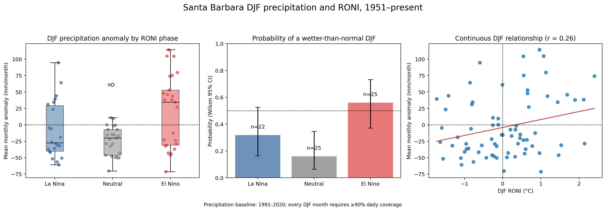

# DJF RONI and Santa Barbara precipitation: modeling methodology

## 1. Research question

This analysis asks:

> Are El Niño-like DJF conditions associated with a higher probability of a wetter-than-normal winter in Santa Barbara?

The analysis is observational. It estimates association in the available station record; it does not establish that ENSO alone causes local precipitation.

## 2. Analysis unit and period

One observation is one **DJF winter**:

\[
\text{DJF } y = \{\text{December }(y-1),\ \text{January }y,\ \text{February }y\}
\]

For example, DJF 1998 combines December 1997, January 1998, and February 1998. The first possible complete winter is DJF 1951 because the local data begin in 1950.

The current analysis contains 72 valid DJF winters. A winter is excluded if any of its three months lacks adequate local precipitation coverage or has no published DJF RONI value.

## 3. Source data

### Local precipitation

- Source: NOAA NCEI Local Climatological Data (LCD), station `USW00023190`, Santa Barbara Municipal Airport.
- Field: `DailyPrecipitation` from `REPORT_TYPE = SOD` (Summary of Day) records.
- Daily values are summed within each calendar month to obtain monthly total precipitation, \(P_{y,m}\), in millimeters.
- A trace value, `T`, is treated as 0 mm and recorded separately as a trace day.

### ENSO indicator

- Source: NOAA Climate Prediction Center Relative Oceanic Niño Index (RONI).
- Field: `ANOM` for `SEAS = DJF` from `relative_seasonal_ersstv6_roni.csv`.
- RONI is a three-month running relative Niño 3.4 SST anomaly in degrees Celsius. The published DJF RONI is used directly; it is not recalculated here.

## 4. Data-quality rule

For a calendar month with \(D_{y,m}\) days and \(O_{y,m}\) usable daily precipitation observations:

\[
\text{coverage}_{y,m} = 100 \times \frac{O_{y,m}}{D_{y,m}}
\]

A month is eligible only when:

\[
\text{coverage}_{y,m} \ge 90\%
\]

A DJF winter is eligible only if December, January, and February all meet this rule. This prevents incomplete data from being interpreted as low precipitation.

Known LCD gaps, including October 1995 through April 1998, are therefore excluded automatically. The 1997–98 El Niño cannot be evaluated with this local LCD precipitation series.

## 5. Precipitation baseline and anomaly

The precipitation normal for each calendar month is calculated using the 1991–2020 WMO standard climatological-normal period.

For month \(m\):

\[
\overline{P}_{m}^{1991\text{–}2020}
= \frac{1}{n_m}\sum_{y=1991}^{2020} P_{y,m}
\]

where only qualifying months are included in \(n_m\).

The monthly precipitation anomaly is:

\[
A_{y,m} = P_{y,m} - \overline{P}_{m}^{1991\text{–}2020}
\]

The DJF outcome is the **mean of the three monthly anomalies**, in mm/month:

\[
A_y^{DJF} = \frac{A_{y-1,12} + A_{y,1} + A_{y,2}}{3}
\]

The equivalent raw seasonal measure is the mean monthly precipitation:

\[
\overline{P}_y^{DJF} = \frac{P_{y-1,12} + P_{y,1} + P_{y,2}}{3}
\]

Using a mean rather than a three-month total changes only the unit by a constant factor of three; it does not change a correlation or the sign of an anomaly.

## 6. ENSO phase classification

Each valid winter is assigned a RONI phase using its published DJF anomaly, \(R_y^{DJF}\):

\[
\text{phase}_y =
\begin{cases}
\text{El Niño-like}, & R_y^{DJF} \ge +0.5^\circ\text{C}\\
\text{La Niña-like}, & R_y^{DJF} \le -0.5^\circ\text{C}\\
\text{Neutral}, & -0.5^\circ\text{C} < R_y^{DJF} < +0.5^\circ\text{C}
\end{cases}
\]

These labels classify the conditions in one DJF season. They do not by themselves assert an official multi-season ENSO episode, which requires persistence across five overlapping seasons.

## 7. Main binary outcome: wetter-than-normal winter

Define:

\[
W_y =
\begin{cases}
1, & A_y^{DJF} > 0\\
0, & A_y^{DJF} \le 0
\end{cases}
\]

`W_y = 1` means the average DJF month was wetter than its 1991–2020 normal.

For each RONI phase \(g\), the estimated probability is:

\[
\hat{p}_g = \frac{\sum_{y \in g} W_y}{n_g}
\]

The analysis reports Wilson 95% confidence intervals. With \(x\) wetter winters in \(n\) eligible winters and \(z = 1.96\):

\[
\text{Wilson center} = \frac{\hat{p} + z^2/(2n)}{1+z^2/n}
\]

\[
\text{Wilson half-width} = \frac{z}{1+z^2/n}
\sqrt{\frac{\hat{p}(1-\hat{p})}{n}+\frac{z^2}{4n^2}}
\]

This interval is preferable to a simple normal approximation because each ENSO group has only about 20–25 winters.

## 8. Secondary outcomes

The current workflow also reports:

1. Mean and median \(A_y^{DJF}\) for each RONI phase.
2. A **very wet winter** indicator, defined as a DJF anomaly above the 75th percentile of all valid DJF anomalies:

\[
V_y = I(A_y^{DJF} > Q_{0.75})
\]

3. Pearson correlation between continuous DJF RONI and continuous DJF precipitation anomaly:

\[
r = \frac{\sum (R_y-\overline{R})(A_y-\overline{A})}
{\sqrt{\sum(R_y-\overline{R})^2\sum(A_y-\overline{A})^2}}
\]

Pearson \(r\) is descriptive here. The precipitation distribution is skewed and affected by extreme storms, so it should not be interpreted as the sole evidence for or against an ENSO relationship.

## 9. Optional formal probability model

The current script summarizes phase-specific probabilities. A next-step formal model can use logistic regression with Neutral as the reference phase:

\[
\operatorname{logit}[P(W_y=1)] = \beta_0
+ \beta_1 I(\text{El Niño-like})
+ \beta_2 I(\text{La Niña-like})
\]

where:

\[
\operatorname{logit}(p) = \log\left(\frac{p}{1-p}\right)
\]

Then \(e^{\beta_1}\) is the estimated odds ratio for a wetter-than-normal DJF in El Niño-like conditions versus Neutral conditions. Given the small sample, confidence intervals and exact or bootstrap checks should accompany any regression result.

## 10. Figures and outputs

`analyze_djf_enso_probability.py` creates:

- `data/processed/djf_precipitation_roni.csv` — one record per valid DJF winter.
- `data/processed/djf_roni_phase_summary.csv` — phase counts, central tendency, probabilities, and Wilson intervals.
- `figures/djf_roni_precipitation_probability.png` — box-and-scatter distribution, probability comparison, and continuous scatterplot.

## 11. Interpretation rules

Appropriate conclusion:

> El Niño-like DJF RONI conditions were associated with a higher observed probability of wetter-than-normal DJF precipitation in the available Santa Barbara record.

Do not conclude that RONI predicts every winter or that ENSO alone causes a local precipitation outcome. Atmospheric rivers, storm tracks, other climate modes, station-data gaps, and sampling variability also affect the result.
