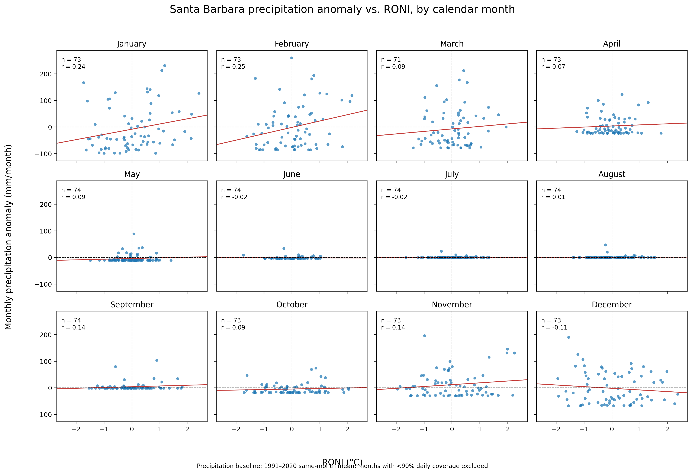

# Calendar-month precipitation anomaly versus RONI

## Purpose

This 12-panel figure is an exploratory month-by-month screen. It asks whether
the relationship between RONI and local precipitation appears stronger in
particular calendar months. It is not the main inferential model.

## Construction of each panel

For each calendar month \(m\), all eligible years are pooled. A point is:

\[
\left(R_{s(m),y}, A_{y,m}\right)
\]

where \(A_{y,m}\) is the precipitation anomaly defined by:

\[
A_{y,m}=P_{y,m}-\overline{P}_{m}^{1991\text{–}2020}
\]

and \(R_{s(m),y}\) is the corresponding centered seasonal RONI. The mapping
is January → DJF, February → JFM, March → FMA, through December → NDJ.

For example, the January panel contains every eligible January from 1950
onward. Its x-coordinate is that year’s DJF RONI and its y-coordinate is that
January’s precipitation anomaly.

## Plot elements

- Blue point: one eligible year-month.
- Horizontal dashed line: \(A_{y,m}=0\), the same-month normal precipitation.
- Vertical dashed line: \(R_{s(m),y}=0\), neutral RONI.
- Red line: ordinary least-squares fit,

\[
\widehat{A}_{y,m}=\widehat{\beta}_0+\widehat{\beta}_1R_{s(m),y}
\]

with

\[
\widehat{\beta}_1=
\frac{\sum(R_i-\overline{R})(A_i-\overline{A})}
{\sum(R_i-\overline{R})^2}
\]

- `n`: number of eligible observations.
- `r`: Pearson correlation,

\[
r=\frac{\sum(R_i-\overline{R})(A_i-\overline{A})}
{\sqrt{\sum(R_i-\overline{R})^2\sum(A_i-\overline{A})^2}}
\]

## Data rules

An observation enters a panel only when the month has at least 90% daily
precipitation coverage and CPC has published its matched RONI value. Missing
local precipitation is excluded, not converted to zero.

## Reading the current result

January (\(r=0.24\)) and February (\(r=0.25\)) have modest positive
associations. Most other months are near zero; December is modestly negative
(\(r=-0.11\)). The panels therefore do not show a stable strong linear
relationship across the year.

This is expected in part because an individual local month can be dominated by
one storm, while RONI represents a three-month ocean-climate background. The
summer panels are also compressed near zero because Santa Barbara is dry in
summer.

## Limit

The panels are exploratory rather than twelve independent confirmatory tests.
Adjacent ENSO seasons overlap: DJF, JFM, and FMA share two months. For the
main analysis, DJF RONI is instead matched to the mean precipitation anomaly
over the same December–February window.
