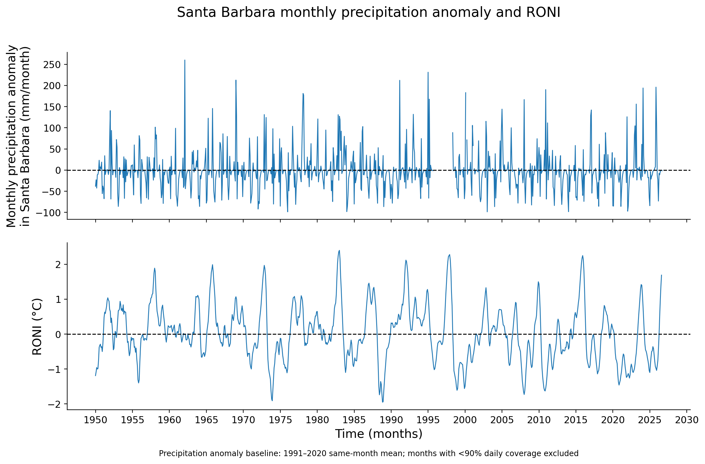

# Santa Barbara monthly precipitation anomaly and RONI

## What the chart shows

The chart has a shared monthly time axis from 1950 to the latest available observations.

- **Upper panel — Monthly precipitation anomaly in Santa Barbara (mm/month):** monthly total precipitation minus the 1991–2020 average total precipitation for the same calendar month. A value above zero means that month was wetter than its 1991–2020 normal; a value below zero means it was drier.
- **Lower panel — RONI (°C):** the Relative Oceanic Niño Index assigned to each calendar month by its centered three-month season: January → DJF, February → JFM, through December → NDJ. Positive values indicate warmer Niño 3.4 conditions relative to the tropical mean; negative values indicate cooler conditions.

The dashed horizontal lines mark zero: normal precipitation anomaly above and neutral RONI below.

## Why the precipitation line has gaps

Monthly rainfall totals come only from daily-summary (`REPORT_TYPE = SOD`) records in the NOAA Local Climatological Data (LCD) files. A month is drawn only when at least 90% of its calendar days have a usable `DailyPrecipitation` value. This rule prevents a partially observed month from being mistaken for an unusually dry month.

The most prominent gap is real source-data unavailability:

| Period | Finding in original LCD files | Treatment in chart |
|---|---|---|
| 1995-10 through 1998-03 | No SOD records and no usable `DailyPrecipitation` values | Left blank |
| 1998-04 | SOD records begin on April 16; only 15 of 30 days are observed (50% coverage) | Left blank |
| 2000-03 | SOD records exist, but all 31 `DailyPrecipitation` values are blank | Left blank |

During 1996 and 1997, the raw files still contain thousands of hourly aviation observations (`FM-15`, `FM-16`, and related records), but `HourlyPrecipitation` is blank in all of those records. These observations therefore cannot be reliably summed to replace the missing daily precipitation totals.

## Why RONI remains continuous

RONI is a separate NOAA Climate Prediction Center ENSO series and does not depend on the Santa Barbara station record. It remains plotted wherever CPC has published a seasonal value, even when the local precipitation record is missing. This preserves the distinction between an ENSO observation and a local rainfall data gap.

The newest RONI values can lag the local LCD precipitation release because CPC publishes completed seasonal values after processing. Thus the latest local months may have an intentionally blank RONI value.

## Interpretation limit

The chart is exploratory. It can show whether wet or dry local months occur near positive or negative RONI conditions, but it does not establish that ENSO caused a particular precipitation event. Formal correlation and lag analyses should exclude months with missing precipitation values.
